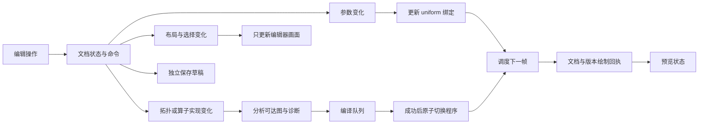

# 自由公式工作台 v2：系统与交互重构方案

日期：2026-10-27。状态：规划；未实施运行代码变更，未发布。

本方案修订 `composable-fractal-nodes.md` 中的实施优先级。上一版的算子数学、图编译和公式包作为基础保留；先建立可持续编辑的工作台，再扩大算子数量和数学表达能力。

## 1. 已确认的使用方式

- 左侧 3D 预览，右侧节点画布，分隔线可拖动；高级检查器可折叠。
- 常用参数直接在节点内部调整，高级参数、公开参数、版本与诊断进入检查器。
- 用户能从零新建自己的节点画布，也能从 UBER、Cube 或混合模板起步。
- 连线决定真实迭代逻辑；修改时能同时看到形态反馈，失败时能知道具体原因。
- 保留当前代码字体、黑白灰与可选强调色，不以更换视觉风格代替交互重构。

主要流程：新建文档 → 添加/连接节点 → 在节点中调参并观察 3D → 保存草稿 → 导出可复用公式。多份实验可以并存、切换和比较。

## 2. 当前问题：代码事实与待验证项

本次检查工作区为 `D:\CodeX\web_release\web_fractal`，分支 `codex/composable-formula-nodes`。已有大量未提交工作及后来加入的录制代码；本轮没有覆盖、重置或提交它们。

| 问题 | 已查到的证据 | 重构处理 |
| --- | --- | --- |
| 拖动时预览延后 | editor.js 的 scheduleCompile 每次 clearTimeout，140ms 后才执行；持续输入可一直推迟 | 参数更新改为按帧合并，持续输出；结构编译单独排队 |
| 更新过程过重 | 每次参数编辑都经图校验、代码生成、打包、iframe.install；适配器又重新建元数据和全部控件 | 参数只改绑定值；结构改变才分析/编译；元数据更新独立 |
| 复用了完整工作室页面 | 预览是 index.html 的 iframe，CSS 隐藏大部分 UI，仍运行该页控件、会话与状态逻辑 | 最终使用专用预览控制器，复用公共渲染算法，不复制工作室控制器 |
| 新建画布缺失 | 只有模板切换与导入；GraphDocument 是一份图＋一个存储键 | 独立工作区、文档标签、文档仓库和新建流程 |
| 空白与半成品无法可靠保存 | save() 要通过完整公式校验；校验要求至少两节点、唯一输入/输出及完整路径 | 草稿校验与可编译校验拆开；未连完也可保存 |
| 中间接线被完整校验阻挡 | graphConnect 立即调用完整 validateGraph | 接线先检查局部端口/环；缺线作为草稿诊断，不禁止继续搭建 |
| 无意中删线 | 现有连线单击直接删除 | 单击选中，Delete/菜单删除；一次操作可撤销 |
| 预览是不是当前图不清楚 | 安装成功即显示“已生效”，没有带文档/版本号的绘制确认；保留旧图时 3D 仍标 LIVE | 输出版本化的绘制回执，过期画面在视窗内标识 |
| 复杂状态隐藏在连线中 | 端口都叫 OrbitState；混合历史取 A 等行为主要藏在说明 | 用中文功能名、类型、作用阶段和状态来源说明层级表达 |
| 小窗口无法边改边看 | 本次在约 315px 宽浏览器中，3D、画布、检查器纵向分散到长页面 | 窄窗口保留常驻小预览和画布；高级设置使用抽屉 |

观察到一次 `MutationObserver.observe` 的 TypeError 日志，尚未定位其来源，不能认定它就是预览故障的根因。需要在运行诊断阶段检查堆栈和绘制链路。

当前代码已有相同 kernel 复用 Program 的分支，因此不能笼统声称“每个数值都重新 GPU 编译”。明确的问题是每个数值仍走完整安装和重建控件的流程。具体“完全不更新”的情况还需用事件→绑定→draw 的记录复现，不能仅凭静态代码下结论。

上一轮检查主要验证静态结果、GPU 数值和导入导出，没有覆盖连续拖动时延及多文档生命周期；这次验收补齐这些缺口。

## 3. 工作区与多画布

采用：工作区 → 多份公式文档 → 每份文档一张根节点画布。子图编辑后续加入，不把多份独立公式误当作同一场景中的多个物体。

### 新建

“＋ 新建”提供三类入口：

1. **空白画布**：零节点，3D 显示空场景和开始提示；不是上一个文档的残留形态。
2. **从起步图新建**：复制已验证的 UBER 或 Cube 算子图，立即有可观察结果。
3. **复制当前文档**：复制数学、视图、材质与布局，但生成新的 documentId、graphId 和相关实体 ID。

模板是只读来源。选择模板默认新开文档，不直接覆盖当前实验。替换当前图是另一项明确操作，可撤销；不把“参考图”下拉框兼作会丢失上下文的文档管理器。

### 文档标签

显示名称、修改/保存状态、编译错误标记及关闭操作。支持重命名、复制、最近文档、关闭后恢复、项目导入/导出。

每份文档独立保存：草稿图、视图平移/缩放、选择、相机、材质/灯光、画质偏好、时间设置、撤销栈。切换文档不共用历史、选中节点或参数值。

只有活动文档拥有正在绘制的预览。其他文档保留最后有效图像与必要缓存，不为每个标签运行一套 iframe 和动画循环。

关闭采用可恢复机制；持久存储失败时明确提示导出备份。不得显示“已保存”却只保存在内存中。

## 4. 布局与可见反馈

桌面结构：

```text
工作区 / 文件菜单     文档 A | 文档 B | ＋新建          保存 / 导出
┌──────────────────┬──────────────────────────────┬──────────┐
│                  │ 节点画布                     │ 高级设置 │
│   3D 实时预览    │                              │ 可折叠   │
│                  │  节点内有常用参数与输入输出   │          │
│ 视角 / 画质      │                              │          │
├──────────────────┤                              │          │
│ 预览状态 / 问题  │ 搜索添加 / 缩放 / 概览        │          │
└──────────────────┴──────────────────────────────┴──────────┘
```

工作台占据可用窗口高度，画布、检查器内部独立滚动。左侧预览与右侧画布之间可调宽度，支持任一区域最大化、恢复布局。折叠检查器释放画布空间，不留空列。

窄窗口是正式使用场景：

- 3D 缩为常驻预览，与画布保持同时可见；可点开大预览。
- 检查器以抽屉呈现，关闭后回到原画布位置。
- 不再把预览、整份图和所有参数排成需要反复上下滚动的长页面。
- 屏幕不足时提供“预览/编辑”聚焦切换，聚焦编辑仍保留小预览；软键盘出现时保证当前字段和必要反馈可见。

沿用现有视觉规范。节点有明确标题、类型和作用，节点内参数是主要操作，不靠极小的全图缩略字完成编辑；全图概览与局部编辑是不同视图目的。

## 5. 参数修改与实时渲染分流



### 参数通道

1. 节点内输入立即更新同一份权威参数值；检查器、公开参数及预览都是订阅者。
2. 普通数值更新不再调用公式安装、activateFormula、整图打包或 renderParameterControls。
3. 同一帧内同一参数只保留最新值。拖动期间按帧/性能预算持续提交，不能用每次输入都会重置的尾随防抖。
4. pointerup/blur 提交最终值，并合并成一条撤销命令。一次拖动对应一次撤销，不按 650ms 猜测用户意图。
5. 参数是否公开只是接口元数据，不是另一套会覆盖节点值的参数副本。
6. 未接入输出的节点照常编辑，明确显示“不影响当前预览”，不能让用户以为系统漏更新。

### 结构通道

只对新增/删除/连接、算子版本和真正的编译常量变化分析/编译。布局、命名、选择、普通 uniform 和公开标记不触发 shader 重建。

编译键基于输出可达的数学结构、算子实现及绑定布局；不依赖数组中的偶然下标、节点位置、图名或不可达节点。

队列最多一个执行中请求＋一个最新待处理请求。输入变化覆盖旧的待处理版本，避免排出几十个无用编译。已提交给驱动的同步编译不能假装能够强制中断；过期结果丢弃并释放资源。

新 Program 成功后一次性交换程序、绑定表和元数据。安装时使用该文档的最新参数快照；编译期间产生的新参数不能被旧编译快照覆盖。不同结构之间不盲目复用旧 uniform 位置。

### 绘制回执

每个请求与结果带 `documentId / graphRevision / parameterRevision / contextGeneration`。只允许活动文档的匹配版本更新当前画面。异步编译完成后再次检查活动文档，跨文档回包不能误切视图。

“已更新”至少意味着对应版本已经上传参数并完成 draw 提交，不能在仅完成校验或安装时就宣布生效。GPU 执行与浏览器呈现不是同一个时刻，诊断分别记录，不用普通 rAF 冒充精确 GPU 完成测量。

## 6. 预览运行时

分两步迁移，避免一次重写导致画面漂移：

**过渡步骤**：为现有适配器新增 patchParameters 和带版本的绘制回执，绕过控件重建。先修复用户正在使用的反馈路径，同时记录安装、编译、绑定和绘制次数。

**最终结构**：独立 GraphPreviewRuntime，使用自己的 canvas、相机输入和渲染调度，复用 src/renderer 的 GPU、材质、光照、采样和预算能力。主工作室也通过显式运行时接口交接公式，不把整个页面当作预览组件。

建议接口：ready、installCompiledGraph、patchParameters、setCamera、setRenderSettings、setInteraction、requestFrame、suspend、dispose；事件为 frameDrawn、compileState、diagnostics、contextLost。

运行时不创建页面参数控件、不选择文档、不写旧工作室预设。主工作室已有录制与离线 MP4 逻辑继续留在自己的控制器；本次不顺带重写它们。

“暂停时间动画”和“停止预览更新”必须区分。关闭自动相位变化后，手动改参数和相机仍要更新。渲染调度有异常保护，单次上传/绘制出错不得让整个下一帧调度永久停止。

编辑交互明确发送 begin/end，拖动时可临时降低采样/分辨率，松手后恢复所选画质。不能依赖发生在父页面的事件自行冒泡到 iframe；也不能以改变迭代次数来偷偷修改公式。

## 7. 接线与节点操作

| 行为 | 新规则 |
| --- | --- |
| 添加 | 双击空白或画布内 Shift+A 搜索；按名称、功能、输入类型过滤；可预览节点说明 |
| 从端口拖到空白 | 打开兼容节点搜索，选择后创建并自动接到确定的兼容端口；多候选不擅自猜测 |
| 双向接线 | 从输入或输出开始均可；兼容端口高亮，非法目标说明原因 |
| 改接已有输入 | 新连接提交前保留原线；放到有效目标后原子替换，取消时恢复 |
| 选中连线 | 单击仅选中；Delete/菜单明确删除，支持撤销 |
| 插入运算 | 节点拖到线附近给出插入预览；确认后替换为两条连接，作为一次命令 |
| 选择与移动 | 左键选择/框选，拖标题移动节点；空格拖动或中键平移；控件拖动不触发节点移动 |
| 导航 | 滚轮缩放围绕指针；F 定位选择、Home 适应全图；检查器和搜索不抢走画布的后续焦点 |
| 复制 | 复制子图与内部连线，生成新 ID，保留相对排布；不得造成公开参数 ID 冲突 |
| 禁用节点 | 明确旁路预览与类型规则；无法安全旁路的节点解释原因，不隐式改公式 |
| 删除节点 | 一次命令删除节点及关联线；公开参数依赖显示影响，撤销可完整恢复 |

端口锚点由真实布局测量，不再硬编码 x+226/y+79 一类偏移；节点内加入参数后连线仍须准确。视觉小端口和点击命中区域分开，缩放后仍可操作。

数值支持精确输入、拖动和步长调整。布尔、轴向、模式使用开关/下拉，不再让用户猜 0/1/2 的含义。角度明确 rad/deg。输入尚未完成、越界和公式计算无效分别反馈，不能一律弹回默认值。

所有更改经命令入口；视图拖动、选择和停靠布局属于编辑器状态，不污染公式撤销。文本输入保留原生撤销；图快捷键只在对应编辑区域生效，不劫持浏览器 Ctrl+N 等快捷键。

## 8. 草稿、校验、错误与保存

拆为三个层次：

1. **文档校验**：可存储、安全、有有效 ID；允许零节点、缺线、暂时无输出。
2. **编辑诊断**：标出缺口、未知算子和局部类型错误，帮助继续编辑。
3. **编译校验**：输出完整可达、类型合法、无非法反馈环、版本和资源满足要求，才可生成程序/导出公式。

空白文档与公式编译失败不同。缺一个输入时，应在该端口标记缺线；不能阻止用户先接其他线，也不能因为半成品而拒绝草稿保存。

3D 视窗内显示：空场景、正在初始化、实时更新、正在重编译、上次成功结果、预览暂停、图无有效输出、图形上下文中断。旧成功画面只属于同一文档；新文档不借用旧文档形态作占位。

节点/连线错误可点击定位。非致命问题、编译失败、绘制失败分层显示；详细面板包含当前文档、请求与画面版本、编译/绘制耗时、最近异常。界面不再只有一个容易被导出成功消息覆盖的 status 字符串。

草稿以防丢失为目标独立自动保存，不以成功渲染为前提。图形上下文丢失不等于草稿丢失；恢复后重装活动文档最近可编译版本并应用最新合法参数。

## 9. 文档格式与兼容

建议新增 `genle-fractal-project` v1，包含工作区与文档；文档中的 draft 有独立的草稿契约，允许空图和不完整节点。不要把这些数据伪装成旧的、要求完整输出的 graph-v1。

分开保存：

- formula：算子/连接/参数/公开绑定与版本依赖。
- editor：节点位置、分组、画布视图、选择、停靠布局。
- preview：相机、灯光、材质、画质与时间配置。
- recovery：草稿版本、最近保存时间和可恢复状态。
- runtime：程序/绑定/GPU 资源只存在运行时，不写 JSON。

工作区索引与文档持久存储建议使用独立 IndexedDB 仓库，支持事务、按文档读取和迁移；主题/语言继续使用现有键。优先实测存储配额和失败恢复，不把本地存储视作无限可靠。

保留并兼容旧 genle-composer-graph-v1、节点图 JSON、公式包、原工作室预设及旧节点页。首次迁移复制原数据并保留备份，不能先删旧数据再写新格式。未知算子在项目草稿中保留原始数据、显示占位节点且不执行，允许将来恢复。

导出分为“项目文件”（所有文档及编辑状态）、“节点图”（一份可继续编辑的图）、“公式包”（完整可运行的形态及公开参数）、“渲染预设”（携带公式依赖与外观/相机）。不使用互相混淆的通用 JSON 名称。

公开参数的默认值和当前值在新模型中分别定义。导出旧公式包时显式适配其 v1 约束，不偷偷改变旧 schema 的含义。自定义公式不写成缺失图依赖的旧预设记录。

## 10. 数学模型分层

现有 22 种状态算子先作为专家层保留，维持两张原公式参考图与 GPU 对照。面向常见创作提供有中文说明的复合起步节点；允许展开查看内部构成。

后续加入 Float、Vec3、Angle、条件和时间端口，把球坐标转换、角度/半径幂、笛卡尔重建进一步拆开。全状态端口与普通向量端口不能直接互接，转换应显式。

数学能力升级在预览、文档和基本编辑稳定之后实施。保留 heuristic/conservative 等距离可靠性信息；合法连线并不保证混合图拥有保守 DE。不要为保证“总有画面”而默默改参数、填线或将异常值伪造为表面。

时钟与相位驱动独立于手动实时更新；初期就划清接口，但时间节点在后续阶段接入，避免再次把动画暂停和手动预览冻结绑定。

## 11. 模块与任务归属

| 模块 | 负责内容 |
| --- | --- |
| src/contracts/ | Draft、Document、PreviewRuntime、命令/事件、版本回执契约 |
| src/state/ | DocumentStore、WorkspaceStore、命令历史、仓库、旧数据迁移 |
| src/graph/ | 草稿分析、可达图编译、稳定绑定、编译请求/诊断 |
| src/renderer/ | DOM 无关预览运行时、程序安装/patch、帧调度与资源生命周期 |
| src/ui/nodes/composer/ | 工作区外壳、标签、节点视图、控件、接线、选择、停靠面板 |
| src/ui/studio/ | 过渡适配器、公式包交接；不承载图编辑器的文档状态 |
| src/formulas/ | 算子实现、参数/单位、数值规则及原公式对照 |
| config/、scripts/ | 新模块构建、检查、测试入口；由集成集中维护 |

先确定接口再迁移调用方；现有 IIFE 词法依赖需要逐项拆解，不能只移动文件后宣称已解耦。保持主工作室/旧节点页画质、相位和材质 profile 的差异，以及新加入的录制功能。

本轮暂不指定第三方节点框架。用首批交互原型验证性能与维护成本后，再判断是否需要依赖；不把换框架当作实时预览问题的解决方案。

## 12. 开发批次与停止条件

| 批次 | 交付 | 验收门槛 |
| --- | --- | --- |
| A：预览基础 | 事件/帧追踪、参数 patch、结构队列、绘制回执 | 连续拖动时持续出新帧；普通参数零 shader 重编译、零控件整树重建；异常后仍能继续更新 |
| B：文档基础 | 空白新建、模板新建、多标签、草稿保存、独立历史/相机 | 两份图切换不串值；半成品刷新可恢复；新空白图绝不显示另一图形态 |
| C：工作台交互 | 左右可调布局、节点内参数、折叠检查器、接线/插入/选择 | 不滚出预览也能改参数；连线不会单击误删；新插入算子一次撤销可恢复 |
| D：运行时迁移 | 专用 preview、资源回收、持久格式迁移、上下文恢复 | 退掉完整工作室 iframe；既有样本外观/数值回归通过；旧文件继续载入 |
| E：更细数学能力 | 标量/向量/角度端口、复合子图、时间与分段迭代 | 各类型规则与距离策略明确；参考公式仍可还原 |

执行顺序 A → B → C → D → E。A 可以先在现有界面验证，B 不等 C 完成才处理草稿；正式工作台验收必须覆盖 A+B+C。没有这些闭环，不再以“增加了多少节点”作为版本完成标准。

### 首批要做的具体事项

1. 建立参数输入→文档版本→uniform→draw 的记录，复现不更新、连续拖动延后、无输出等不同情况。
2. 实现参数快速通道，结构变更单独进入队列；把“已更新”绑定到绘制回执。
3. 分离空白/不完整草稿的文档合法性与可运行公式校验。
4. 建立两份文档的最小工作区，支持空白和模板新建、切换、自动保存。
5. 通过以上行为验证后，再建立节点内参数控件和新布局，避免在错误状态模型上先重画 UI。

## 13. 用户可感知的验收

| 场景 | 必须看到的结果 |
| --- | --- |
| 连续拖动 5 秒 | 拖动期间出现多个新版本画面，不是松手后才更新；最终值与序列化一致 |
| 连续编辑两个参数 | 后改的值不被旧请求覆盖，最后显示版本等于最新文档版本 |
| 只移动节点 | 无 GPU 编译，无数值变化，无丢焦点 |
| 添加暂未连接的节点 | 可以编辑和保存，明确说明当前不影响结果 |
| 正在编译时切换文档 | 旧回包不改变新文档，旧资源可回收 |
| 新建空白画布 | 新标签、独立 ID、空场景、清楚的开始提示 |
| 改完 A，编辑 B，再回 A | A 的节点、参数、相机、画布与历史保持独立 |
| 拔线后刷新 | 半成品还在，定位缺口；不退回模板或丢掉最后编辑 |
| 编译失败后继续修图 | 同文档旧结果带清楚标记；修好后自动恢复正确预览 |
| 窄浏览器边栏 | 节点参数与小预览同时可见，面板不强迫用户反复滚到页面顶部 |
| 存储失败/上下文丢失 | 显示真实状态，能导出草稿或重新加载，不伪装保存成功 |
| 导出→清空→导入 | 数学结构、公开参数与视图类别按格式正确恢复，无旧预设丢失 |

以本机参考硬件、固定图和固定编辑画质建立性能基线：普通参数到更新帧的目标 P95 ≤150ms，交互目标约 30fps；复杂图、设备差异和首次结构编译单独报告，不承诺所有设备都达到同一数字。预览质量可以降采样，不能改公式。

测试将覆盖真实事件和像素/帧版本变化，不能只断言 dirty=true、控件数值变化或安装函数返回。继续保留两原公式 GPU 数值对照，以及旧工作室、旧节点页、录制和预设回归。

## 14. 本轮结论

已完成现状检查与用户交互方向确认。下一步开发从 A/B 的实时更新和文档模型开始，而不是先增加公式。当前运行版本的问题尚未因这份规划而修复，所有新能力都按后续批次验收。
